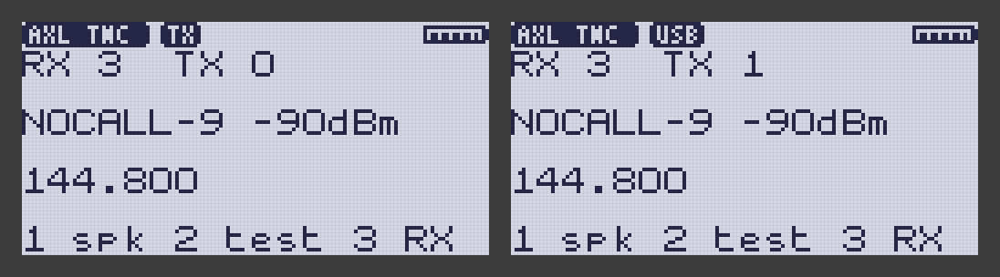

# AXLink TNC — a KISS TNC app for F4HWN radios

<p>
  
  <a href="https://github.com/TechnikWeber/AXLink-TNC/releases/latest"></a>
  <a href="https://github.com/TechnikWeber/AXLink-TNC/releases"></a>
  <a href="https://github.com/TechnikWeber/AXLink-TNC/actions/workflows/ci.yml"></a>
  
  
  
  <a href="LICENSE"></a>
</p>

<p>
  <a href="https://github.com/TechnikWeber/AXLink-TNC/releases/latest"><b>Download</b></a> &nbsp;·&nbsp;
  <a href="https://github.com/TechnikWeber/AXLink"><b>AXLink (the host)</b></a> &nbsp;·&nbsp;
  <a href="https://technikweber.github.io/2026/vom-handfunkgeraet-ins-netz/"><b>Blog post (German)</b></a> &nbsp;·&nbsp;
  <a href="https://github.com/TechnikWeber/AXLink-TNC/releases"><b>Releases</b></a>
</p>

**The Quansheng UV-K1 / UV-K5 V3 as a KISS modem that keeps up with a host sending many
frames.**

A KISS TNC overlay app for the [F4HWN firmware](https://github.com/armel/uv-k1-k5v3-firmware-custom),
for hosts such as [AXLink](https://github.com/TechnikWeber/AXLink) (IPv4 over AX.25). It is
based on the **KISS TNC** app by Johan Denoyer F4WAT, with the demodulator and modulator of the
APRS apps by Armel F4HWN. It stays a standard KISS TNC: APRSdroid and any other KISS client work
as with the original.

> **Status: alpha.** Version 0.2 is KISS TNC 0.9 from F4HWN v6.3.0 plus the three extensions
> below: ACKMODE, a counter for host frames lost, and dropping a frame cut off by a USB reset.
> They pass the host tests (the app's own code against a model of the radio); **the app has not
> run on a radio yet**. Not yet in the UV Studio Community tab. Open points: [TODO.md](TODO.md).



*Left: sending a frame from the host (`TX`) after three frames received from `N0CALL-9`;
right: afterwards, with the host connected over USB. Rendered on a PC, not photographed: the
app's own code runs in the host test harness, and the firmware's drawing services with its
fonts (`App/apps/af_lcd.py`) draw the LCD (`bash scripts/render-screens.sh`). Placeholder
callsign; the battery symbol is drawn full.*

## What it adds to KISS TNC

A host that does not use them sees the original behaviour; APRSdroid works as before.

| Extension | What it does | Commit |
|---|---|---|
| **ACKMODE** (G8BPQ's KISS extension, command `0x0C`) | The host sends `C0 0C hi lo <frame> C0`; once the frame has left the TNC the app answers `C0 0C hi lo C0`. The host knows when to send the next frame instead of estimating it. A frame dropped in RX-only mode is answered too, so the host never waits forever. | [4a25af6](https://github.com/TechnikWeber/AXLink-TNC/commit/4a25af6) |
| **Host frames lost** | A frame from the host that arrives while another one waits for the channel is dropped (the app holds one). It is now counted in `lost N` on line 3, like the frames dropped in RX-only mode, so a host that sends too fast shows on the screen. | [ce3a675](https://github.com/TechnikWeber/AXLink-TNC/commit/ce3a675) |
| **USB reset** | RF on the USB cable at key-up can reset the radio's USB port (`re` on line 5). A frame the host was sending is cut off; the original let the next FEND close it and sent it on air truncated. Now a reset, or a lapped receive ring (`ov`), drops the half frame and the parser waits for the next FEND. | [b9537d4](https://github.com/TechnikWeber/AXLink-TNC/commit/b9537d4) |

Why: the original app holds one frame from the host and reads its 256-byte USB ring at
16 bytes per 10 ms. That suits APRSdroid (one frame per beacon) but not a host that carries
IP traffic. [AXLink](https://github.com/TechnikWeber/AXLink) uses ACKMODE with the profile
`f4hwn-kisstnc-ackmode` and paces its writes with the original app (`f4hwn-kisstnc`). Flow
control on the USB port itself is part of the resident firmware and cannot be done in an app;
it is discussed upstream in
[Discussion #764](https://github.com/armel/uv-k1-k5v3-firmware-custom/discussions/764).

Planned next: identification on request (KISS SetHardware `0x06`: name, version, maximum
frame length, ACKMODE) and the RSSI of each received frame for the host.

## Runs on

| Firmware | Works | Why |
|---|---|---|
| F4HWN **Labs v6.3.0** (original) | yes | overlay-app platform, API level 3 |
| F4HWN **Fusion v7** (when released) | expected | ABI 1, same overlay address; rebuilt if v7 changes the ABI |
| Fusion v6.3, other v6.3 editions | no | no app loader |

The loader checks only the ABI, the API level, the capabilities and the link address; this
build has ABI 1, API level 3, capability serial and address `0x20000280`. No messenger and
no Multiboot are needed.

## Install

1. Run F4HWN Labs v6.3.0 on the radio.
2. Download the zip from [Releases](https://github.com/TechnikWeber/AXLink-TNC/releases)
   and unzip it (GitHub does not accept `.app` files as release assets). The current one,
   v0.2.0-alpha.1, has not run on a radio yet: try it on the bench first.
3. In [UV Studio](https://armel.github.io/uvstudio/), open **Apps → Community → Install a
   .app**, choose `AXLinkTNC.app` and a free slot.
4. On the radio: `F` + `7`, select **AXLink TNC**, `MENU`.

Screen, keys and the USB-C connection are those of KISS TNC; see [app/README.md](app/README.md).
Use a clip-on ferrite at the radio end of the USB cable when transmitting.

> [!IMPORTANT]
> Transmitting needs an **amateur radio licence**. The app is alpha and comes **"as is",
> without any warranty**; installing apps or firmware on your radio is at your own risk
> (see [LICENSE](LICENSE)).

With AXLink: `axlinkd run -call <CALL>-1 -ip 10.73.0.1/24 -port auto -profile
f4hwn-kisstnc-ackmode` (`-port auto` finds the radio by its USB ID). Any other KISS host works
without changes; one that sends `0x0C` frames gets the ACKMODE answers.

## Build

```sh
git clone --recurse-submodules https://github.com/TechnikWeber/AXLink-TNC.git
cd AXLink-TNC
bash scripts/build.sh            # host tests, then dist/AXLinkTNC.app
bash scripts/render-screens.sh   # docs/images/screen.png from the app's own drawing code
```

Needs `arm-none-eabi-gcc` (F4HWN uses the ARM GNU Toolchain 13.3.rel1), `python3`, and `gcc`
or `clang` for the host tests. `firmware/` is the F4HWN repository as a submodule at the
release tag the app targets; the build uses a copy of `firmware/App/apps` and leaves the
submodule untouched.

## Taking the code into KISS TNC

`app/` keeps the file names of `App/apps/kisstnc` in the F4HWN firmware. The first commit is
the original app, unmodified; every change after it is a separate commit (the three
extensions above are one commit each, with their host tests). A change can be taken over with
`git format-patch` / `git am` (strip the leading `app/`), or copied file by file. No pull
request is needed for that.

## Related

- [AXLink](https://github.com/TechnikWeber/AXLink): the host software (Go, GPL-3.0).
  `internal/sim/f4hwnkiss` is a behavioural model of this app used in its tests;
  `internal/pacing` and `internal/tnc` show how a host feeds it.
- [APRS messenger fork](https://github.com/TechnikWeber/uv-k1-k5v3-aprs-firmware): a
  separate firmware with background APRS messaging; not needed for this app.

## License

Apache License 2.0, like the original: [LICENSE](LICENSE), [NOTICE](NOTICE). Modified files
carry a notice.
